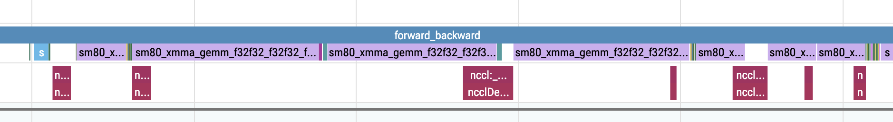
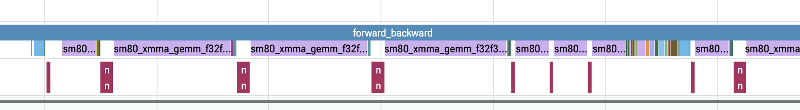

I ran FSDP wrapped transformer with just in time weight gathering and pre fetching. I used the torch profiler and Perfetto to view it. 

See profiles/fsdp/19032278 for the prefetched version, and 
profiles/fsdp/19036982 for the just in time version. 

Prefetched:

Just in time:

You can see just in time is more communication bound, but its not perfect and I could prefetch a little sooner